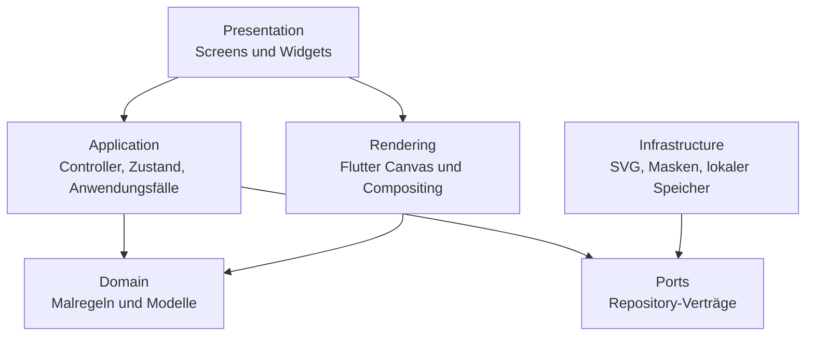
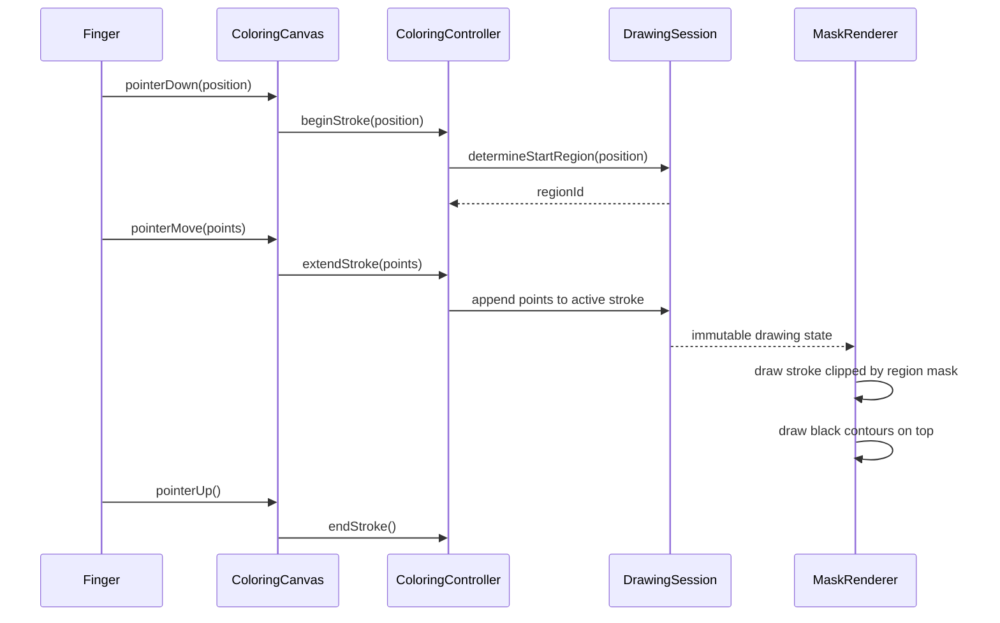

# Pinselino — Architektur

## 1. Architekturentscheidung

Das Projekt verwendet eine **Feature-first-Architektur mit drei einfachen
Schichten und gezielten Ports an technischen Grenzen**.

Es ist bewusst keine vollständige Hexagonal- oder Enterprise-Clean-Architecture.
Hexagonale Prinzipien werden dort genutzt, wo Austauschbarkeit und Testbarkeit
konkret helfen: Laden von Motiven, Speichern von Bildern und gegebenenfalls
Audio oder Käufe.

Ziele:

- für Menschen und Coding Agents schnell verständlich
- Business-Logik ohne Flutter-UI testbar
- Renderingtechnik klar von Malregeln getrennt
- kleine vertikale Features statt globaler Schichten
- offline-first und ohne Backend in Version 1

## 2. Abhängigkeitsrichtung



Regeln:

- Domain importiert weder Flutter noch Plugins, Dateisystem oder UI.
- Presentation enthält keine fachlichen Malregeln.
- Application koordiniert Zustandsänderungen und Anwendungsfälle.
- Infrastructure implementiert Ports und darf Flutter-/Plugin-Details kennen.
- Rendering darf Flutter Canvas kennen, entscheidet aber keine Produktregeln.
- Abhängigkeiten zeigen nach innen; konkrete Adapter werden von außen
  bereitgestellt.

## 3. Fachlicher Kern

Voraussichtliche Kernmodelle:

- `ColoringPage`: Motiv, Abmessungen und Teilflächen
- `ColoringRegion`: geschlossene ausmalbare Fläche mit stabiler ID
- `Brush`: Werkzeugart, Größe und Darstellungsparameter
- `PaintStroke`: Punkte, Farbe, Werkzeug und zugeordnete Region
- `DrawingSession`: aktueller Zustand inklusive Undo-/Redo-Historie

Zentrale Invarianten:

1. Beim Beginn eines Strichs wird genau eine Teilfläche bestimmt.
2. Der gesamte Strich bleibt dieser Startfläche zugeordnet.
3. Farbe und Radierer wirken außerhalb dieser Fläche nicht.
4. Schwarze Konturen werden nach der Farbe als oberste Ebene gerendert.
5. Undo entfernt einen vollständigen Benutzerstrich atomar.
6. Redo wird nach einem neuen Strich verworfen.
7. Speichern und Laden erhalten das sichtbare Ergebnis und die für Fortsetzung
   notwendige Sitzung konsistent.

Diese Regeln sind Business-Logik und müssen automatisiert getestet werden.

## 4. Mal- und Rendering-Datenfluss



## 5. Motivformat

Version 1 verwendet vorbereitete Vektormotive mit:

- stabiler Motiv-ID
- geschlossenen Teilflächen mit stabilen IDs
- separater Konturebene
- definierter ViewBox/Koordinatenbasis
- Metadaten für Titel, Kategorie und Vorschau

Ein Import-/Validierungsschritt muss offene Pfade, doppelte IDs, zu kleine
Flächen und ungültige Geometrie erkennen. SVG bleibt das editierbare
Quellformat. Ein Build-Schritt validiert und konvertiert es in vorverarbeitete,
normalisierte Vektorgeometrie mit stabilen IDs. Die App parst im Malpfad kein
beliebiges SVG und verwendet Rastermasken nur als späteren begründeten Fallback.
Details und Alternativen stehen in `docs/MOTIF_PIPELINE.md`.

## 6. Vorgesehene Projektstruktur

```text
lib/
├── app/
│   ├── app.dart
│   ├── navigation.dart
│   └── theme/
├── features/
│   ├── coloring/
│   │   ├── domain/
│   │   ├── application/
│   │   ├── presentation/
│   │   ├── rendering/
│   │   └── infrastructure/
│   ├── page_selection/
│   └── gallery/
└── shared/
    ├── geometry/
    └── widgets/
```

Nicht jedes Feature muss alle Unterordner besitzen. Ein Ordner wird erst
angelegt, wenn er Inhalt hat.

## 7. Zustandsverwaltung

Pro geöffnetem Motiv gibt es eine eindeutige Zustandsquelle, voraussichtlich
`ColoringController` plus unveränderlichen `ColoringState`.

Widgets senden Absichten wie `beginStroke`, `selectColor`, `undo` oder `reset`.
Sie manipulieren keine Stroke-Listen direkt. Die konkrete State-Management-
Bibliothek wird erst nach einem kleinen Spike entschieden; die Architektur darf
nicht von ihr abhängen.

## 8. Ports

Für Version 1 sind höchstens folgende Ports vorgesehen:

- `ColoringPageRepository`: Motivkatalog und Motivdaten laden
- `ArtworkRepository`: Fortschritt und fertige Werke lokal speichern/laden
- optional `SoundPlayer`: kurze App-Sounds abstrahieren

Keine Interfaces für Farben, Buttons, Navigation oder andere rein interne
Details auf Vorrat.

Der derzeitige `ProgressStore` ist der konkrete Port für Malfortschritt. Die
Produktlogik arbeitet nur gegen diesen Vertrag; der Produktionsadapter nutzt
`SharedPreferences`, Tests nutzen einen speicherinternen Adapter. Das JSON-
Format besitzt eine Versionsnummer. Nicht lesbare oder fremde Versionen werden
als leerer Fortschritt behandelt, und nicht mehr vorhandene Regions-IDs werden
beim Wiederherstellen verworfen.

## 9. Nichtfunktionale Anforderungen

- Kernfunktion vollständig offline
- flüssiges Zeichnen auf unterstützten Tablets und Smartphones
- keine Werbung, Accounts oder Tracking-SDKs in Version 1
- robuste Wiederaufnahme nach App-Neustart
- große Touchziele und Nutzung ohne Lesekenntnisse
- Elternbereich für externe Aktionen und spätere Käufe

Messbare Performancebudgets und unterstützte Geräte werden im technischen
Prototyp festgelegt.
